# Jornada Linux Terminal
## User Guide & Manual

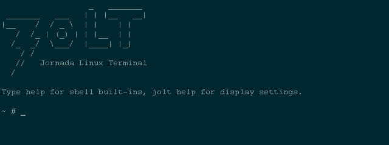

## Contents

1. [The basics](#1-the-basics)
2. [The "jolt" command](#2-the-jolt-command)
3. [Keys and Hot Keys](#3-keys-and-hot-keys)
4. [Shortcuts](#4-shortcuts)
5. [Programs & Memory](#5-programs--memory)
6. [Scripting](#6-scripting)
7. [Files and Windows CE](#7-files-and-windows-ce)
8. [Networking](#8-networking)
9. [Serial and IR](#9-serial-and-ir)
10. [Limitations](#10-limitations)

# 1. The basics

JoLT is, more or less, a proto Windows Subsystem for Linux, an application with enough glue to make largely unmodified (outside of selecting for lean programs) Linux applications run. It doesn't emulate Linux, nor run the Kernel, it doesn't take over your device or affect your existing Windows CE install. What it does is give you enough Linux goodness to accomplish common tasks on the go.

## Requirements

- HP Jornada 720 (or another Windows CE 3.0 H/PC with a StrongARM CPU)
- A CompactFlash card with a few MB free

## Installing

Copy the `JoLT` folder from a release `.zip` to the root of your CF card, so you have:

```
\Storage Card\JoLT\JoLT-Term.exe
```

Everything JoLT needs lives in that folder. Its `root` subfolder is the Linux filesystem, `/` in the shell. Nothing is written to the registry or to the rest of your device, except shortcuts you create with `jolt shortcut`.

## Launching

Run `JoLT-Term.exe` from the File Explorer, or from a shortcut (see [Shortcuts](#4-shortcuts)). A splash screen shows while the shell starts, then you get the welcome message and a `~ #` prompt.

- `exit` closes JoLT and returns to the desktop.
- Only one JoLT window runs at a time. Launching it again brings the existing window to the front.
- If a command run from a shortcut exits, JoLT shows its exit status. Press Escape to close.

## Getting around

The shell is BusyBox `ash`. If you've used `bash`, most things work as you'd expect: pipes, redirection, `$(...)`, `&&`, globbing, functions, background jobs, `#!` scripts.

- `help` lists shell built-ins.
- `jolt help` lists JoLT's own settings.
- `ls /bin` lists BusyBox commands, `ls /usr/bin` the bigger programs.
- Command history is kept in `/.ash_history`. Up and Down step through it, Ctrl+R searches it.
- Ctrl+C interrupts, Ctrl+Z suspends, `fg`, `bg` and `jobs` work as normal.

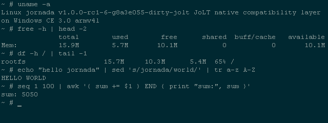

# 2. The "jolt" command

```
jolt COMMAND [ARGUMENTS]
```

`jolt` controls the terminal itself and links JoLT to Windows CE. Display settings are saved in `JoLT\jolt.cfg` and remembered next time.

| Command | Description |
| --- | --- |
| `jolt fs` | Full screen, hides the taskbar |
| `jolt win` | Window, taskbar visible, with a scroll bar |
| `jolt dm` | Dark mode |
| `jolt lm` | Light mode |
| `jolt theme classic\|solarized` | Colour theme |
| `jolt font N` | Font height in pixels, 8 to 32 (default 16) |
| `jolt face NAME\|default` | Fixed-width font (default Courier New) |
| `jolt fonts` | List the fonts that come with JoLT |
| `jolt mount` | List CE folders mounted into the Linux tree |
| `jolt mount CEPATH DIR` | Mount a CE folder at `DIR` |
| `jolt umount DIR` | Remove a mount |
| `jolt open FILE` | Open a file in its CE application, e.g. Pocket Word |
| `jolt battery` | Battery and power status |
| `jolt shortcut [-s] NAME COMMAND` | Desktop shortcut that opens JoLT and runs `COMMAND` (`-s`: Start menu) |
| `jolt hotkeys off\|fullscreen\|always` | When the HP hot keys run commands from `/etc/hotkeys` |
| `jolt keys` | Show the next 20 keyboard messages JoLT receives |
| `jolt serial-shell [DEVICE [SPEED]]` | Run a login shell on a serial port, see [A shell over serial](#a-shell-over-serial) |
| `jolt help` | Show help (also `-h`, `--help`) |

Examples:

```sh
jolt fs
jolt theme solarized
jolt font 12
jolt mount '\Storage Card\Photos' /mnt/photos
jolt open /mnt/docs/letter.pwd
jolt shortcut "Laptop" "ssh user@192.168.1.10"
```

## Themes and display

There are two colour themes, `classic` and `solarized`, each with a light and dark mode.

| | Light | Dark |
| --- | --- | --- |
| Classic | 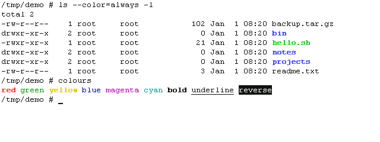 | 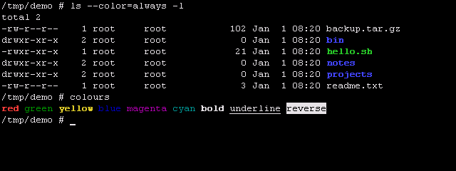 |
| Solarized | 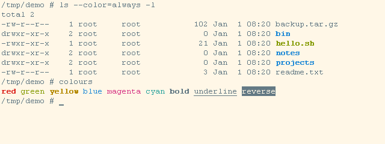 | 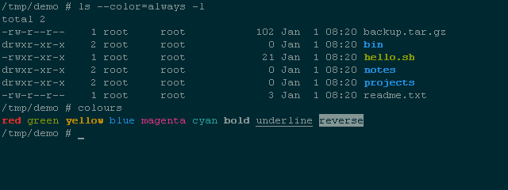 |

Windowed mode (`jolt win`) keeps the taskbar and adds a scroll bar you can drag with the stylus:

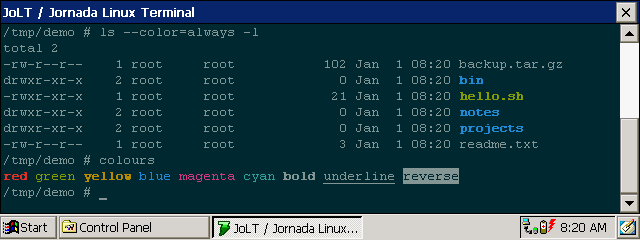

Smaller fonts fit more on screen. At 16 px the full screen is 79x15. At 12 px it's 106x20:

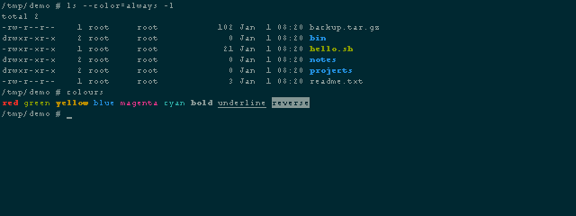

### Fonts

JoLT uses CE's Courier New unless you pick another fixed-width font. It comes with DejaVu Sans Mono and Liberation Mono:

```sh
jolt fonts
jolt face DejaVuSansMono
jolt face default
```

Names work with or without spaces, so `jolt face "DejaVu Sans Mono"` does the same. To add a font, copy its regular and bold `.ttf` files into `/usr/share/fonts`, named so they start with the font's name without spaces (`DejaVuSansMono.ttf`, `DejaVuSansMono-Bold.ttf`). Fonts installed in CE's `\Windows\Fonts` work too. JoLT only loads the font you pick, and CE has no anti-aliasing, so well-hinted fonts look best at small sizes. A name that isn't a fixed-width font leaves the current one in place.

### Bitmap fonts

JoLT also draws two pixel fonts itself, Spleen and Terminus. They stay sharp at small sizes, where TrueType fonts break up:

```sh
jolt face spleen
jolt font 8
```

| Font | Sizes (`jolt font`) | Full screen at the smallest size |
| --- | --- | --- |
| `spleen` | 8 (5x8), 12, 16, 24 | 127 columns, 30 rows |
| `terminus` | 12 (6x12), 14, 16, 18, 20, 24 | 106 columns, 20 rows |

Bitmap fonts only come in these sizes. `jolt font N` picks the largest size that isn't bigger than N, and `@font+` and `@font-` step to the next one. Terminus has its own bold; Spleen's bold is drawn one pixel wider. Characters a bitmap font doesn't have are drawn with Courier New.

## System information

`joltfetch` (or `neofetch`) shows a summary of the device:

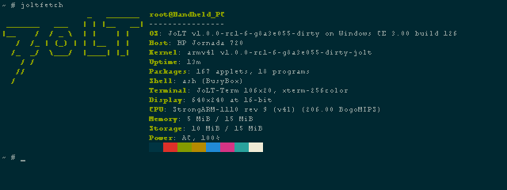

# 3. Keys and Hot Keys

## Keyboard

| Keys | Action |
| --- | --- |
| Shift+PgUp / Shift+PgDn | Scroll back through output a page at a time |
| Shift+Up / Shift+Down | Scroll back a line at a time |
| Any other key | Jump back to the live screen |
| Ctrl+1 to Ctrl+0 | F1 to F10 |
| Ctrl+- / Ctrl+= | F11 / F12 |
| Ctrl+Shift+F | Switch between full screen and windowed, even inside a program |
| Ctrl+C | Interrupt the running program |
| Ctrl+Z | Suspend the running program (`fg` to resume) |
| Ctrl+D | End of input; at an empty prompt, closes the shell |
| Ctrl+R | Search command history |
| Escape | Close JoLT once its command has exited |

The Jornada has no function keys, so Ctrl+number stands in for them. In htop, for example, Ctrl+0 (F10) quits. Alt+number doesn't work: the Jornada's keyboard driver uses Alt for its own layer (Alt+Up is PgUp).

`jolt keys` logs the next 20 keyboard messages JoLT receives, which is handy for finding out what a key actually sends.

## HP hot keys

The row of application buttons above the keyboard (Inbox, Calendar, Contacts and so on) can run JoLT commands. Assign them in `/etc/hotkeys`, one per line:

```
# HOTKEY COMMAND
6 cal
5 htop
4 joltfetch
```

When pressed, the command is typed into JoLT followed by Enter, so it runs in whatever is in front: the shell, or a program that's waiting for input.

A command starting with `@` changes a terminal setting instead, so it works inside vim or htop too:

```
1 @toggle
volume-up @font+
volume-down @font-
```

The settings are `@toggle` (full screen or windowed), `@fullscreen`, `@window`, `@dark`, `@light`, `@font=N`, `@font+` and `@font-` (2 pixels bigger or smaller), and `@theme=NAME`. With `jolt hotkeys fullscreen`, the buttons stop working once you leave full screen, so use `always` if you want a button to switch back.

| Number | Button | Number | Button |
| --- | --- | --- | --- |
| 1 | Internet Explorer | 7 | HP Viewer |
| 2 | Inbox | 8 | HP quick pad |
| 3 | Voice Recorder | 9 | Pocket Access |
| 4 | Contacts | 10 | Pocket Excel |
| 5 | Tasks | 11 | Pocket Word |
| 6 | Calendar | | |

The media keys are `player`, `volume-up`, `volume-down` and `play-pause`.

`jolt hotkeys` sets when JoLT takes over the buttons:

- `off`: never, buttons launch their usual CE applications
- `fullscreen` (default): only while JoLT is full screen
- `always`: whenever JoLT is in front

While JoLT has the buttons, unassigned numbered buttons do nothing and unassigned media keys keep their usual action.

# 4. Shortcuts

Shortcuts are a handy way to launch JoLT right into the application or command you want.

`jolt shortcut` makes one for you:

```sh
jolt shortcut "Laptop" "ssh user@192.168.1.10"
jolt shortcut -s "Top" "htop"
```

The first puts a "Laptop" icon on the desktop, the second adds "Top" to the Start menu. Names can't contain `\ / : * ? " < > | ;`.

Under the hood, a shortcut runs `JoLT-Term.exe` with these options, which you can also use from your own `.lnk` files or the Run dialog:

| Option | Description |
| --- | --- |
| `-e "COMMAND"` | Run `COMMAND` in a login shell, close JoLT when it exits |
| `--hold -e "COMMAND"` | Run `COMMAND`, then drop to a shell instead of closing |

Options go before `-e`. If the command fails, JoLT stays open with its exit status until you press Escape.

Things to do with them:

- `ssh user@host` to a server or your desktop
- `vim /mnt/docs/todo.txt` to jump straight into a file
- `htop` or `joltfetch` for a quick look at the system
- `zork` for a game on the train
- `micropython` or `lua` for a calculator that's better than Calculator
- `microcom -s 115200 /dev/ttyS0` for a serial console
- `links http://example.com` to go straight to a page
- `--hold -e "cd /mnt/docs"` to start a shell in your documents

# 5. Programs & Memory

JoLT uses memory as and when programs are loaded, sharing with your Windows CE environment. Some programs, like links and vim, can be quite large and may take a moment to start up (loading from your CF card into RAM).

Every running program is its own CE process. Memory is freed when the program exits. Free memory is shown by `free -h` and `joltfetch`. If you run short, close CE applications or other JoLT programs. Only 16 Linux processes can run at once.

## Programs

These live in `/usr/bin`:

| Program | Description |
| --- | --- |
| `vim` | Vim 9.2, tiny build (no syntax highlighting or plugins) |
| `nano` | Nano 9.2 text editor |
| `bash` | GNU Bash 5.3, for scripts that need it. The login shell stays BusyBox `sh` |
| `links` | Text-mode web browser with HTTPS |
| `curl` | Fetch URLs, with HTTPS |
| `ssh` / `dbclient` | Dropbear SSH client |
| `dropbearkey` | Generate SSH keys |
| `micropython` | MicroPython 1.29 (unix port) |
| `lua` | Lua 5.4 |
| `jq` | JSON processor |
| `htop` | Process viewer (Ctrl+0 quits) |
| `dvtm` | Several shells in one screen, see [Windows with dvtm](#windows-with-dvtm) |
| `ncdu` | Disk usage browser, needs more than 15 rows: use `jolt font 12` |
| `frotz` | Z-machine interpreter for text adventures |
| `zork` | Zork I, II or III: `zork 2` |
| `joltfetch` | System summary, also `neofetch` |
| `jolt` | Terminal settings and CE integration, see [The "jolt" command](#2-the-jolt-command) |

| | |
| --- | --- |
| 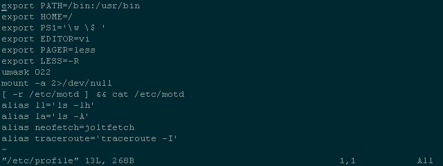 | 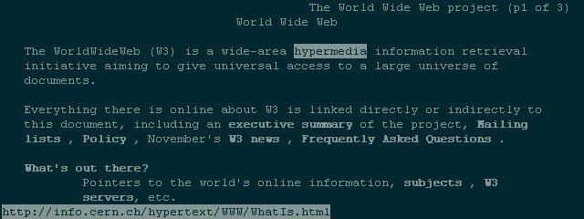 |
| 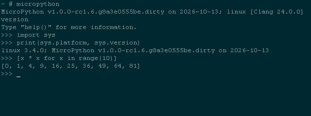 | 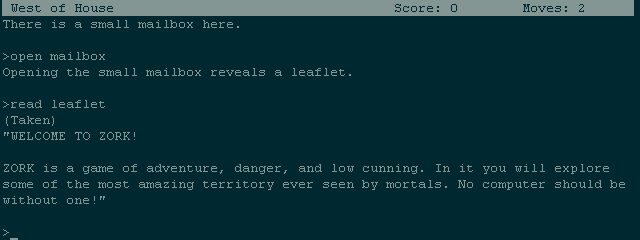 |

## Windows with dvtm

`dvtm` splits the screen into several terminals, each running its own shell. Start it with `dvtm`. It opens one window; add more as you need them.

Every dvtm command is Ctrl+G followed by a key. Ctrl+G twice sends a real Ctrl+G to the program in the window.

### Windows

| Keys | Action |
| --- | --- |
| Ctrl+G c | New window with a shell |
| Ctrl+G x x | Close the current window |
| Ctrl+G j / Ctrl+G k | Next / previous window |
| Ctrl+G 1 to Ctrl+G 4 | Jump to window 1 to 4 |
| Ctrl+G Tab | Back to the last window you used |
| Ctrl+G Enter | Swap the current window into the main area |
| Ctrl+G . | Minimise or restore the current window |
| Ctrl+G q q | Quit dvtm and every window in it |

### Layout and sizing

| Keys | Action |
| --- | --- |
| Ctrl+G f | Tiled: one main window on the left, the rest stacked on the right |
| Ctrl+G b | Bottom stack: main window on top, the rest side by side below |
| Ctrl+G g | Grid |
| Ctrl+G m | Full screen: only the current window |
| Ctrl+G Space | Cycle through the layouts |
| Ctrl+G h / Ctrl+G l | Make the main area smaller / bigger (5% a press) |
| Ctrl+G i / Ctrl+G d | More / fewer windows in the main area |
| Ctrl+G s | Hide or show the status bar |
| Ctrl+G r | Redraw the screen |

Each window's size follows the layout, so `h` and `l` resize the main window and everything beside it at once. Programs inside are told their new size, so vim and htop redraw to fit.

### Scrolling back

| Keys | Action |
| --- | --- |
| Ctrl+G PgUp / Ctrl+G PgDn | Scroll the current window's history (PgUp is Alt+Up on the Jornada) |

JoLT's own Shift+PgUp scrolls the whole screen, not a single dvtm window, so use dvtm's keys instead.

### Tips

- JoLT has 4 pseudo terminals, so dvtm can have up to 4 windows, fewer if `script` or `jolt serial-shell` are using one.
- Smaller fonts give each window more room: at `jolt font 12` in full screen, two tiled windows are about 53 columns each.
- `jolt fs`, `jolt font` and the other settings work from inside a dvtm window, as do Ctrl+Shift+F and the hot keys. dvtm resizes to match.
- Programs inside dvtm see `TERM=dvtm-256color`, which JoLT's programs understand.

## BusyBox commands

Everything else is a BusyBox applet in `/bin`. `COMMAND --help` shows the options each one supports.

- **Files:** `ls cp mv rm mkdir rmdir ln link unlink touch find tree stat du df realpath readlink basename dirname install mktemp truncate sync fsync`
- **Text:** `cat head tail more less grep egrep sed awk cut tr sort uniq wc tee nl paste fold rev tac comm diff patch cmp expand unexpand tsort split strings dos2unix unix2dos printf echo xargs`
- **Editors:** `vi ed hexedit`
- **Archives:** `tar gzip gunzip zcat bzip2 bunzip2 bzcat unzip unxz xzcat unlzma lzcat cpio`
- **Checksums and encoding:** `md5sum sha1sum sha256sum sha384sum sha512sum sha3sum cksum crc32 sum base32 base64 uuencode uudecode od hexdump xxd`
- **Processes:** `ps top pstree kill killall pgrep pkill pidof pwdx nice renice nohup setsid timeout time watch flock`
- **System:** `uname uptime free date cal sleep usleep env printenv id whoami logname hostname nproc tty ttysize stty clear reset mount umount beep`
- **Network:** `wget nc telnet ftpget ftpput tftp httpd nslookup whois ping traceroute ssl_client`
- **Serial:** `microcom`
- **Maths and misc:** `bc dc expr factor seq shuf yes true false test [ [[ getopt mkpasswd ascii ts which`

# 6. Scripting

Binaries loaded by Jolt must be compiled and marked in a specific way, you can't just throw any old Linux thing in /usr/bin and expect it to work. With sh, MicroPython and Lua, however, you can at least script your own.

## Shell scripts

A script is executable if it's in a `bin` folder or its name ends in `.sh`. The CF card's FAT filesystem has no permission bits, so `chmod +x` doesn't change that.

```sh
cat > /usr/bin/backup <<'EOF'
#!/bin/sh
tar czf /mnt/docs/jolt-etc.tar.gz /etc
echo "saved"
EOF
backup
```

Or run any script directly with `sh script`.

## Lua and MicroPython

```sh
lua -e 'print(2^32)'
micropython -c 'print(sum(range(100)))'
```

Both work as `#!` interpreters too, for scripts in a `bin` folder. Elsewhere, run them with `micropython script.py` or `lua script.lua`:

```python
#!/usr/bin/micropython
import os
print(os.listdir("/"))
```

MicroPython includes `asyncio`. It doesn't have threads, `ffi` or `ssl`.

## Other Linux binaries

Programs built with JoLT's toolchain (see `apps/` in the source) carry a marker the loader checks. To try a static ARMv4 soft-float binary built elsewhere, set `JOLT_ALLOW_UNMARKED=1`:

```sh
JOLT_ALLOW_UNMARKED=1 ./myprogram
```

It may or may not work. Dynamically linked programs, threads and ARM instructions newer than ARMv4 aren't supported.

# 7. Files and Windows CE

## Where things are

| Linux path | Windows CE |
| --- | --- |
| `/` | `\Storage Card\JoLT\root` |
| `/mnt/docs` | `\My Documents` |
| `/bin` | BusyBox commands (virtual) |
| `/dev`, `/proc` | Virtual devices and system information |

## Mounting CE folders

`/etc/fstab` lists folders mounted at login. Use `\040` for spaces:

```
\My\040Documents /mnt/docs cefs defaults 0 0
```

`jolt mount` adds more on the fly, `jolt umount` removes them, and `jolt mount` on its own lists them.

## Opening files in CE applications

`jolt open FILE` opens a file as if you'd tapped it in the File Explorer, e.g. a `.pwd` in Pocket Word or a `.htm` in Internet Explorer.

## Clipboard

`/dev/clipboard` is the CE clipboard:

```sh
cat /dev/clipboard
uname -a > /dev/clipboard
```

Line endings and text encoding are converted for you.

## Devices

| Device | Description |
| --- | --- |
| `/dev/null`, `/dev/zero` | As usual |
| `/dev/random`, `/dev/urandom` | Random bytes from CE CryptoAPI |
| `/dev/tty`, `/dev/console` | The terminal |
| `/dev/clipboard` | CE clipboard |
| `/dev/ttyS0` to `/dev/ttyS3` | Serial ports, see [Serial and IR](#9-serial-and-ir) |
| `/dev/ptmx`, `/dev/pts/0` to `/dev/pts/3` | Pseudo terminals, for `dvtm`, `script` and `jolt serial-shell` |

`/proc` has `cpuinfo`, `meminfo`, `uptime`, `loadavg`, `mounts`, `apm` (battery), `version`, `jolt` (device details) and a folder per process.

## Filesystem notes

- FAT is case-insensitive: `Notes.txt` and `notes.txt` are the same file.
- No symlinks, hard links or Unix permissions. Files are read-only or not.
- Names can't contain `\ : * ? " < > |`.
- Keep copies of important files. Saves are not crash-safe if the battery dies mid-write.

# 8. Networking

JoLT uses whatever network CE has: PPP or ActiveSync over the serial cable, a CF or PC Card network adapter, or a modem. Connect in CE first, then use the network from JoLT.

```sh
ping -c 3 example.com
wget -O - https://example.com
curl -I https://example.com
links http://example.com
ssh user@host
```

DNS goes through CE's own resolver. Add local names to `/etc/hosts`.

`ntpd -q -n` sets the clock from the servers in `/etc/ntp.conf` (`pool.ntp.org`) and exits. `date -s "2026-10-13 12:00"` sets it by hand. HTTPS certificate checks need the clock to be right.

## SSH

`ssh` is Dropbear's `dbclient`. To log in with a key:

```sh
mkdir -p /.ssh
dropbearkey -t ed25519 -f /.ssh/id_dropbear
dropbearkey -y -f /.ssh/id_dropbear | grep ^ssh-
ssh user@host
```

Add the `ssh-ed25519 ...` line to the server's `~/.ssh/authorized_keys`. Your home folder is `/`, so `/.ssh/id_dropbear` is used automatically. Agent and X11 forwarding aren't available.

## Serving files

`httpd -p 8080 -h /mnt/docs` serves your documents to other machines on the network.

# 9. Serial and IR

| Device | CE port | Description |
| --- | --- | --- |
| `/dev/ttyS0` | `COM1:` | The serial cable |
| `/dev/ttyS2` | `COM3:` | IrDA (IrCOMM) |
| `/dev/ttyS3` | `COM4:` | Raw infrared |

`COM1:` is busy while PPP or ActiveSync is connected over the cable. Disconnect first.

```sh
microcom -s 115200 /dev/ttyS0
```

Exit `microcom` with Ctrl+X. `stty -F /dev/ttyS0` shows and changes port settings.

## A shell over serial

`jolt serial-shell` runs a login shell on a serial port, so you can use the Jornada from another computer's terminal:

```sh
jolt serial-shell                       # /dev/ttyS0 at 115200
jolt serial-shell /dev/ttyS0 38400 &    # in the background, keep using JoLT
```

On the other end, connect at the same speed, for example `picocom -b 115200 /dev/ttyUSB0`. The shell has a proper terminal: Ctrl+C, job control and full-screen programs work. It ends when you type `exit`; run it again for another session.

# 10. Limitations

- JoLT runs programs built for it, not arbitrary Linux binaries.
- No threads. Programs that need them are left out or built without them.
- No X, framebuffer or graphics, only the terminal.
- No `sudo`, users or permissions. You're always `root`.
- The Jornada has 32 MB of RAM shared between storage and programs. Large programs or many at once can run out.
